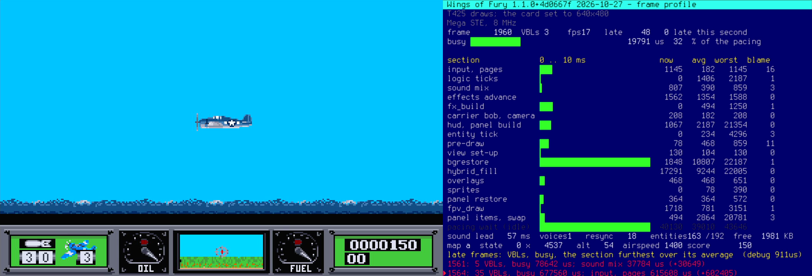
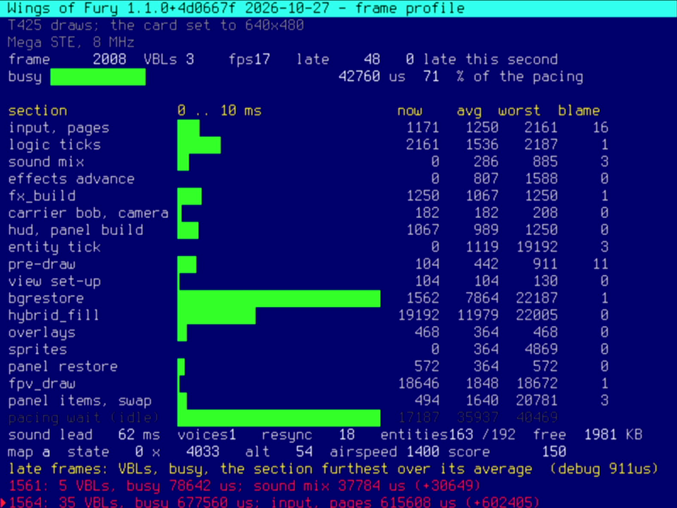

# atw-snoop

**▶ [Video and downloads: atari.love/atw-snoop](https://www.atari.love/atw-snoop/)** ·
**[Wings of Fury reference build (hard disk, zip)](https://www.atari.love/atw-snoop/wof-atw-snoop.zip)** ·
**[Demo (zip)](https://github.com/theimann/atw-snoop/releases/latest)**

A live debug screen for Atari programs, on the second video output of an **ATW800/2** graphics
card. The program keeps its own screen; atw-snoop shows what it is doing
on the card's HDMI output at the same time: timings, counters, memory, a log. The card's own
processor, a T425 transputer, does the formatting and drawing, so the program under test pays
little more than one bus write per value.



*Left: Wings of Fury on the Mega STE's own screen. Right: the same frames measured live on the
ATW800/2. Video: [atari.love/atw-snoop](https://www.atari.love/atw-snoop/)*

## The ATW800/2

atw-snoop exists because of the [ATW800/2](https://www.geekdot.com/atw800_2/), a Transputer graphics
card for the Atari, and the team behind it:

- **Axel Muhr** ([GeekDot](https://www.geekdot.com/atw800_2/)): the card and the project
- **Claus Meder**: the "Seurat" FPGA graphics core and the T425 core this tool draws with
- **Wolfgang "Idek" Hiestand**: the Nova drivers for the card (xVDI)
- **André Saischowa**: the INMOS tools, the Helios server and the NVDI drivers
- with **Mike Brüstle** ([transputer.net](https://www.transputer.net/)) as the Transputer expert

## What it does

- **Runs from plain TOS.** No ATW800/2 graphics driver (xVDI, NVDI) and nothing else resident: the
  library finds the card by itself, boots its T425 and sets the card to 640×480. Nothing stays in memory
  to disturb the program being measured, which is what game development wants.
- **A second screen that costs almost nothing.** The 68000 writes raw values into the card's
  shared memory over VME; the T425 compares, formats and draws. A value shown every frame is one
  long write (about 9 µs at 8 MHz).
- **Text grid on the card:** 80×30 cells in the card's own 640×480 mode; 16 colours; Terminus 8×16
  font; bars, a sweep graph, a scrolling log.
- **Slots:** a field defined once (hex, decimal, bar, bytes) and fed raw values; decimal slots can
  scale (e.g. timer counts shown as microseconds) without any multiply or divide on the 68000.
- **A clock for timing code:** MFP timer C at 38400 counts a second (26 µs), safe to read at any
  point of the frame, also inside games that take over the machine.
- **Falls back cleanly:** without a working T425 the 68000 draws a few cells a frame; without a
  card every call returns at once, so a debug build runs on any ST.

## The method, and where it has been tested

- **The method** applies to any machine that takes an ATW800/2 in its VME slot: the **Mega STE and
  the TT**. It relies only on the card (its shared memory and T425) and on MFP timer C, which both
  machines have.
- **Tested:** on a **Mega STE with TOS 2.06 under plain TOS** (no card driver loaded) only: the
  library, the demo and the Wings of Fury reference build, at 8 and 16 MHz (cache on and off). Without
  a card, also in Hatari (STE, TOS 1.62 and 2.06), where everything runs as without atw-snoop.
- **Not tested:** the **TT** (68030, TOS 3.0x), other TOS versions on the Mega STE, and the current
  version with the xVDI desktop running (see below).

## Performance cost

Measured on a Mega STE at 8 MHz with the card's T425 drawing (details: [docs/MEASUREMENTS.md](docs/MEASUREMENTS.md)):

| What | Cost |
|---|---|
| a word written into the card over VME | 4.4 µs (3.8 µs to ST RAM) |
| a value shown every frame through a slot (`snoop_set`) | one long write: two VME words |
| formatting on the 68000 instead (the demo, ~140 values a frame) | 5.1 ms a frame (2.8 ms at 16 MHz with the cache) |
| reading the clock (`snoop_clock`) plus storing it, per profile marker | about 20 µs |
| a complete frame profile in a game (Wings of Fury: 18 sections, ~25 values) | about 0.8 ms a frame, 1.3 % of its 60 ms frame |
| the same in a second game (Super Cars II: slots plus markers) | 0.55–0.75 ms a frame |
| a log line (`snoop_log`: the 68000 writes the whole line and scrolls) | up to 4 ms at 16 MHz: keep it to a few lines a second, never one a frame |
| without a card, calls guarded by `if (snoop_mode)` | one test a frame |
| ST RAM | 17 KB for a 100×40 grid; the font and the T425 program are in the program file |

What makes it cheap: the 68000 only writes raw values; the T425 compares, formats, scales and draws
in its own time, on its own memory. The bus write itself is cheap; what used to cost was formatting
the numbers on the 68000, and slots hand that to the T425. Measuring still has a price: in a scripted run of Wings of Fury the debug
build had 122 late frames of 3698 against 80 of 3713 without it, so compare builds with the debug
screen against each other.

## Requirements

- A Mega STE or TT with an ATW800/2 card in the VME slot (tested: Mega STE, TOS 2.06).
- Plain TOS: no card driver, nothing resident (tested that way: the Wings of Fury reference build and
  the demo, started from the desktop or the hard disk). The library sets the card to 640×480 itself
  and switches its output off at the end.
- Not the intended use: with the card's xVDI driver running, the library borrows the desktop's screen
  (256 colours, 100×40) and the desktop redraws itself afterwards. Only an earlier version of the demo
  was tried that way; the current version and the reference build were not.
- To build: `m68k-atari-mint-gcc` (gcc 4.6 cross compiler) and Python 3 for the T425 program.
  The generated T425 program is in the repository, so a project that only uses the library
  needs no Python.

## Use in a program

Compile one C file with the program: `src/atwsnoop.c` (with `atwsnoop.h` and `snoopprog.h`
beside it). It works with and without `-mshort` and from C++. All calls in supervisor mode.

```c
#include "atwsnoop.h"

static short s_frame, s_busy;

void debug_start(void)          /* once, before the program takes over vectors and the MFP */
{
    if (!snoop_init(0)) return;                     /* no card: everything below does nothing */
    snoop_cls(SNOOP_NORMAL);
    snoop_puts(1, 0, SNOOP_ATTR(SNOOP_BLACK, SNOOP_CYAN), "my game - frame profile");
    snoop_puts(1, 2, SNOOP_NORMAL, "frame          busy        us");
    s_frame = snoop_slot(SNOOP_DEC, 7, 2, SNOOP_NORMAL, 8, 0);
    s_busy  = snoop_slot(SNOOP_DEC, 21, 2, SNOOP_NORMAL, 6, 26042);   /* clock counts shown as us */
}

void debug_frame(long frame, unsigned long t0)    /* once a frame */
{
    if (!snoop_mode) return;
    snoop_set(s_frame, frame);
    snoop_set(s_busy, snoop_clock() - t0);
    snoop_frame();
}

void debug_end(void) { snoop_exit(); }            /* before the program ends */
```

The full API is in [`src/atwsnoop.h`](src/atwsnoop.h); [docs/HOW_IT_WORKS.md](docs/HOW_IT_WORKS.md)
explains the card side, [docs/MEASUREMENTS.md](docs/MEASUREMENTS.md) gives the costs measured on
a Mega STE.

## Reference build: Wings of Fury

A complete example of the method in a real game, **tested on a Mega STE with TOS 2.06 only**: a
reference build of the Mega STE version of Wings of Fury ([source](https://github.com/theimann/wings-of-fury-atari-ste), branch `atw-snoop`), ready to run
from a hard disk. It is a showcase of atw-snoop, not a release of the game (the game itself:
[atari.love/wof](https://www.atari.love/wof/)). Download:
[wof-atw-snoop.zip](https://www.atari.love/atw-snoop/wof-atw-snoop.zip) from
[atari.love/atw-snoop](https://www.atari.love/atw-snoop/). The zip is not covered by this repository's
MIT licence: the game's data is © Brøderbund, and the program contains AGT (Atari Game Tools by dml)
under its own terms.

The reference build shows a frame profile on the card: 18 code sections between profile markers,
each with a live bar and its current, average and worst time, the frame's busy time against the
3-VBL pacing, sound and entity figures, and a log of every frame that ran late with the section
that overran most. A scripted run plays the same flight every time, so changes can be compared.
What it found and how the debug code itself was made cheap: [docs/WINGS_OF_FURY.md](docs/WINGS_OF_FURY.md).



## The demo

`make` builds `build/ATWSNOOP.TOS`: ST low on the ST's screen with a moving bar, and on the card
the frame, the clock, the cost of the debug calls themselves (also shown as a red stretch of the
ST's background colour), the ST palette and MFP registers live, a sweep graph and a log.
Command line: a number of seconds (ends by itself), `s` (the figures as slots), `n` (the 68000
draws), `f` / `c` (Mega STE at 16 MHz without / with the cache). Ctrl+Q ends it.

## Tests without hardware

- `make test`: the T425 program in a T425 emulator (`t425/temu.py`): every pass pixel-exact, the
  slots of every kind cell by cell.
- `make e2e`: the demo end to end, the 68000 under [unicorn](https://www.unicorn-engine.org/)
  and the card emulated: xVDI desktop, own 640×480 mode and a dead link, each with and without
  slots; the drawn page checked against the grid. Needs `pip install unicorn pillow`.

## Layout

| Path | What |
|---|---|
| `src/` | the library: `atwsnoop.c`, `atwsnoop.h`, `snoopprog.h` (the T425 program, generated) |
| `t425/` | `build_snoop.py` (the T425 program), `t425base.py` (memory map, boot loader), `tasm.py` (assembler), `temu.py` (emulator) |
| `demo/` | `snoopdemo.c`, `crt0.S` |
| `tests/` | `test_snoop.py`, `test_e2e.py` |
| `fonts/` | Terminus 8×16 (`ter-u16n.bdf`) |
| `docs/` | how it works, measurements, the Wings of Fury case |

## Credits and licences

- atw-snoop: MIT licence ([LICENSE](LICENSE)).
- Doing the drawing on the T425 follows the approach of
  [MATRIX-T425](https://github.com/stephane-perez/atw800-matrix-demo) by Stéphane Perez; `t425/tasm.py`
  and `t425/temu.py` are based on its T425 assembler and emulator (MIT,
  [t425/LICENSE.matrix](t425/LICENSE.matrix)).
- The ATW800/2: Axel Muhr ([GeekDot](https://www.geekdot.com/atw800_2/)), Claus Meder, Wolfgang Hiestand,
  André Saischowa, with Mike Brüstle.
- Terminus font by Dimitar Toshkov Zhekov, SIL Open Font Licence 1.1 ([fonts/OFL.TXT](fonts/OFL.TXT)).
- Written with Claude Code.
